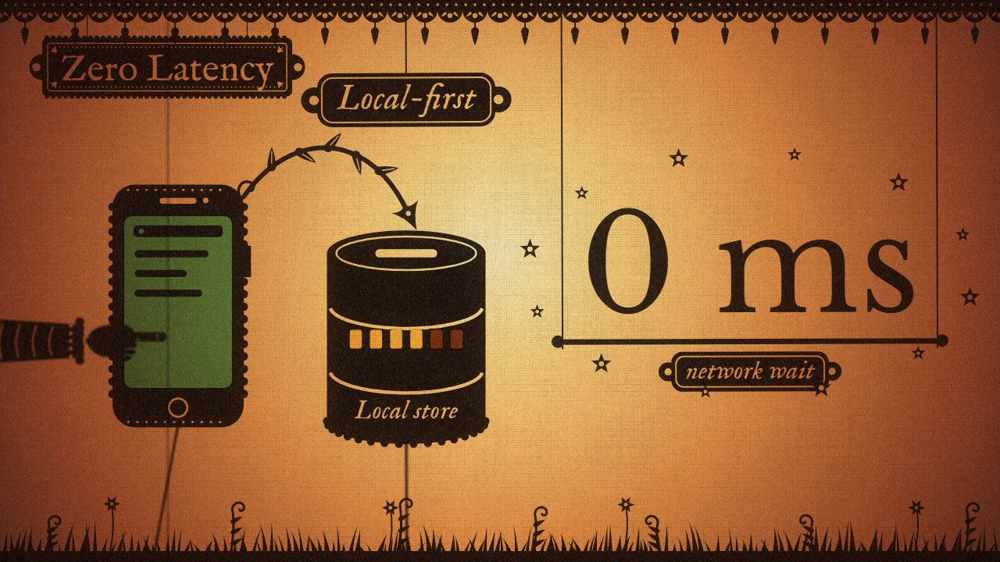
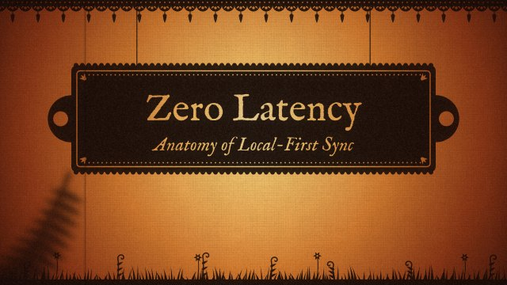
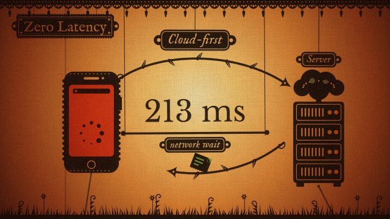
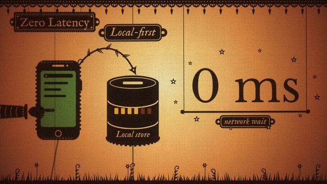
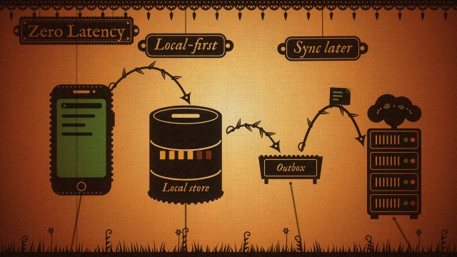
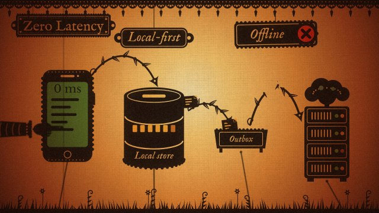
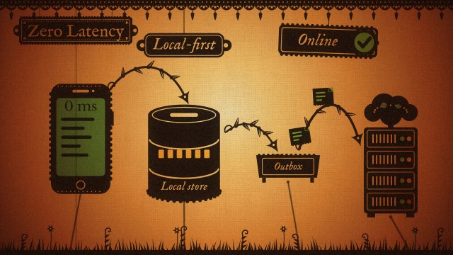
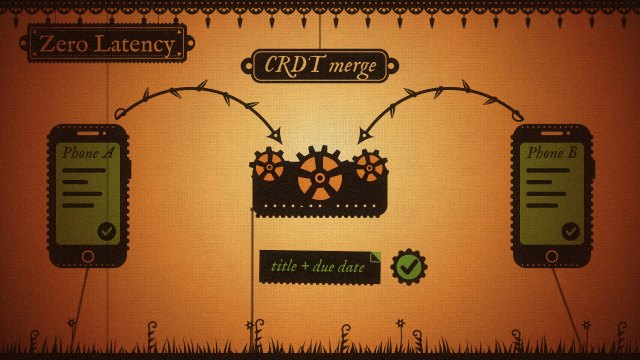
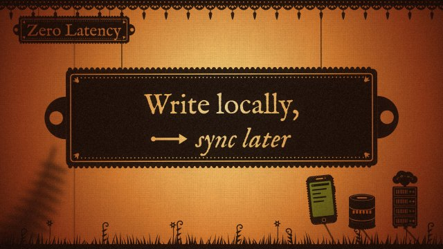

# Zero Latency: Anatomy of Local-First Sync

[](https://www.youtube.com/watch?v=ZTZd61-V0xA)

**▶ [Watch it on YouTube](https://www.youtube.com/watch?v=ZTZd61-V0xA)**, or build the pages and play it live in your browser.

A 15-second explainer in a shadow-puppet theatre style. It is drawn entirely on a 1280×720 canvas, with no images or audio files: the puppets are paths with punched holes, the light, cloth and grain are computed, and the sound is synthesized with Web Audio. Every frame is a pure function of time `t`, so the same `t` always gives the same picture.

- **No assets.** Every puppet, gel, weave and grain is code. Every sound is synthesized.
- **Deterministic.** `explainer(ctx, W, H, t)` draws the same frame for the same `t`, which makes scrubbing, storyboards and frame-exact video export straightforward.
- **One timing table.** The picture and the sound are both scheduled from the `T` table in `scene.js`, so they can't drift apart.
- **Single-file pages.** The build inlines everything into self-contained HTML files with no runtime dependencies.

## The story in eight beats

<table>
  <tr>
    <td width="50%"><br><b>1 · Hook</b> <sub>0.0 – 1.9 s</sub><br>The lamp sputters alight and the title card drops in on its strings.</td>
    <td width="50%"><br><b>2 · Cloud-first</b> <sub>1.9 – 4.2 s</sub><br>Every tap goes to the server and back. The board counts a 280 ms wait.</td>
  </tr>
  <tr>
    <td><br><b>3 · Local-first</b> <sub>4.2 – 6.2 s</sub><br>The same tap writes straight into a local store: 0 ms network wait.</td>
    <td><br><b>4 · Background sync</b> <sub>6.2 – 7.8 s</sub><br>A copy drops into the outbox and rides the sync vine to the server.</td>
  </tr>
  <tr>
    <td><br><b>5 · Offline</b> <sub>7.8 – 9.25 s</sub><br>Scissors cut the vine. Writes are still instant and pile up in the outbox.</td>
    <td><br><b>6 · Back online</b> <sub>9.25 – 10.2 s</sub><br>The vine heals and the queued notes flush to the server.</td>
  </tr>
  <tr>
    <td><br><b>7 · Merge</b> <sub>10.2 – 12.9 s</sub><br>Two phones edit different fields offline. A CRDT merge keeps both.</td>
    <td><br><b>8 · Takeaway</b> <sub>12.9 – 15.0 s</sub><br>Write locally, sync later.</td>
  </tr>
</table>

## Quick start

```sh
npm run build
```

This writes three self-contained pages to `dist/`:

| Page | What it is |
| --- | --- |
| `dist/index.html` | Landing page linking the other two, each with a key-frame preview |
| `dist/zero-latency.html` | The player: the full piece with sound, plus play, scrub, sound and loop controls |
| `dist/storyboard.html` | The eight key frames with timings, on-screen text, transitions, sound cues and the assumptions behind the numbers |

Open `dist/index.html` in a browser. The build needs only Node, with no `npm install`. The pages load IM Fell English and Libre Baskerville from Google Fonts.

## Layout

```text
src/
  harness.js            H helper library: seeded RNG, noise, easing, colour, canvas layers, vignette
  sound.js              SOUND kit: synthesized effects, beds, live playback and offline rendering
  scene.js              the style and the story: lamp, cloth weave, gels, puppets, explainer(ctx, W, H, t), DURATION, T timing table
  score.js              scoreSound(k): the sound design, scheduled from the same T table as the picture
  player.tpl.html       player page (canvas + controls)
  storyboard.tpl.html   storyboard page (eight key frames + notes)
  index.tpl.html        landing page linking the player and the storyboard
build.cjs               inlines src/ into self-contained pages in dist/
render.cjs              headless Chrome (Puppeteer) + ffmpeg -> MP4
vercel.json             static deploy config for Vercel
docs/                   README images
dist/                   build output (git-ignored): built pages, plus the MP4 if you render one
```

## Render the video

None of the HTML pages use a video file. The player draws every frame live on the canvas and synthesizes the sound as it plays. The MP4 is only for platforms that need a video file, such as [YouTube](https://www.youtube.com/watch?v=ZTZd61-V0xA) or social posts.

You need Node 18+ and ffmpeg on your PATH.

```sh
npm install
npm run render
```

`render.cjs` opens the player page in headless Chrome through Puppeteer. It renders the sound first with `SOUND.renderOffline(scoreSound, DURATION, 48000)` in an OfflineAudioContext. Then, for each frame, it calls `window.seek(i / 30)`, reads the canvas back as PNG and pipes it into ffmpeg (libx264, CRF 17), and finally muxes the audio as AAC. A 15-second render takes about a minute and a half.

If the render machine can't reach Google Fonts, use `npm run render:local` instead. It builds a copy of the player that loads the same fonts from the `@fontsource` npm packages.

To use your own Chrome rather than the one Puppeteer downloads, set `CHROME=/path/to/chrome`. Pass `--fps 60` to `render.cjs` for a different frame rate.

The video is written to `dist/zero-latency.mp4`, which is git-ignored. It is never deployed with the site, so keep it out of the repo and upload it to the platform directly.

## Deploy

The site is plain static HTML. [vercel.json](vercel.json) tells Vercel to skip the install step, run `node build.cjs` and serve `dist/`. Leave the framework preset on **Other**. Pushes to `main` deploy to production, and pushes to other branches get preview deployments.

To host it anywhere else, run `npm run build` and serve the `dist/` folder.

## Editing

- **Timings** live in the `T` table near the bottom of `scene.js`. `score.js` reads the same values, so moving a beat moves its sounds with it.
- **Text** is set where each scene draws it: `header`, `sceneCloud`, `sceneLocal`, `sceneMerge` and `sceneEnd` in `scene.js`.
- **Puppets** are `phone`, `server`, `drum`, `note`, `outbox`, `scissors` and `mergeMill`. The rest (the lamp, cloth weave, grain, plaques, vines, tags, title cards, curtains and hand) comes from the style reference.

The player page exposes `window.seek(t)`, `window.DURATION` and `window.scoreSound` for frame-by-frame rendering.

## How the frames were checked

During development, `render.cjs`-style Puppeteer scripts rendered chosen times to PNG. ffmpeg's `hstack`/`xstack` filters tiled those PNGs into contact sheets for review.

The images in `docs/` are key frames drawn by `explainer()` at the storyboard's times and exported from the canvas as JPEG.
